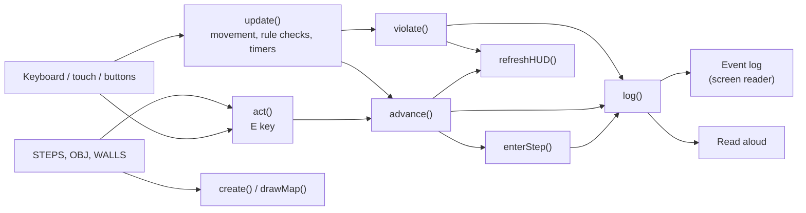

# B035 Lab Safety Simulator

A browser-based 2D lab safety drill set in room B035, the chemical engineering lab. Walk through the room, follow the safety steps, and respond to a spill, an eye splash and a fire alarm. It is designed to be playable with a keyboard, a screen reader, or read-aloud speech.

**Play online:** https://YOUR-USERNAME.github.io/b035-lab-safety-sim/ (replace with your GitHub Pages address)

This README has two parts:
- [Part 1: For players](#part-1-for-players): how to play
- [Part 2: For developers and contributors](#part-2-for-developers-and-contributors): how the code works and how to extend it

---

# Part 1: For players

## Getting started

Open the link above in Chrome, Edge or Firefox. Nothing needs to be installed.

To play without the website, download `index.html` and double-click it (an internet connection is still needed to load the game engine).

There are two versions:
- **Simple view** (`index.html`): the whole floor plan is visible at once, with high-contrast shapes and large labels. Recommended for low-vision players and screen reader users.
- **Pixel-art view** (`pixel.html`): a close-up, game-style view where the camera follows your character.

## Playing with a partner

Two players can play together on two laptops on the same Wi-Fi. One laptop runs `server.py`; see [TWO-PLAYER.md](TWO-PLAYER.md) for setup. With two players, both must gear up, both must stand at the spill to contain it, and both must evacuate.

## Controls

| Action | Keyboard | Touch / mouse |
|---|---|---|
| Walk | WASD or arrow keys | Press and hold on the map |
| Interact, or read an object's safety note | E (or Space) | **Interact** button |
| Describe your surroundings | Q | **Describe** button |
| Start over | | **Restart** button |

Holding Shift makes you run, but running in the lab costs points.

## The drill

Follow the task card on the right. There are 8 steps:

1. Put on PPE at the cubbies by the entrance.
2. Get acetone from the flammables cabinet.
3. Dispense it in the fume hood.
4. Return it to the cabinet.
5. A spill appears: fetch the spill kit from the blue cabinet.
6. Clean up the spill without walking through it.
7. Eye splash: reach the eyewash station (below the centrifugal pump) within 10 seconds.
8. Fire alarm: leave through the nearest exit within 25 seconds.

A ring on the map marks your current target: green for normal tasks, red for urgent ones.

## Scoring

You start with 100 points and lose 10 for each of these (each counts once):
- Leaving the entrance area without PPE
- Dispensing acetone on an open bench
- Carrying acetone near the steam bench or heat exchanger
- Walking through the spill
- Running
- Missing a timer

## Accessibility features

- **Keyboard only.** The whole game can be played with the keyboard.
- **Screen readers.** Every instruction, success and mistake is posted to the event log, which screen readers announce automatically.
- **Read aloud.** The game can speak events itself. It is on by default; **turn it off if you use a screen reader**, or you will hear everything twice.
- **Describe (Q).** Tells you the three nearest objects, how far away they are in metres and in which compass direction, plus where your current target is. North is the top of the map.
- **Proximity cues.** You hear an object's name when you walk up to it, and "Press E" when you can use it.
- **Timer warning.** You hear "5 seconds left" during timed tasks.
- **Safety notes.** Press E next to any object to hear its safety note.

## Settings

| Setting | What it does |
|---|---|
| Read events aloud | Speaks every event (on by default) |
| Highlight the current target | Shows or hides the target ring |
| Alarm and alert sounds | Turns sound effects and the fire alarm on or off |

---

# Part 2: For developers and contributors

## Project files

| File | What it is |
|---|---|
| `index.html` | Simple view. The whole game is in this one file. |
| `pixel.html` | Pixel-art view. Same drill and rules, with a different renderer and in-canvas HUD. |
| `server.py` | Optional two-player server (Python standard library only). See `TWO-PLAYER.md`. |
| `TWO-PLAYER.md` | How to run a two-laptop session |
| `README.md` | This file |

This part describes `index.html`. `pixel.html` follows the same structure and uses the same names.

## Development setup

Serve the folder locally so it behaves like a real website:

```bash
python -m http.server 8000
# then open http://localhost:8000/
```

To work offline, download [phaser.min.js 3.80.1](https://cdnjs.cloudflare.com/ajax/libs/phaser/3.80.1/phaser.min.js) into the same folder, and change line 10 of `index.html` to:

```html
<script src="phaser.min.js"></script>
```

To test accessibility, try the game with a real screen reader (NVDA on Windows, VoiceOver on macOS) with read-aloud turned off.

## Code map

The file has three parts: **CSS** (lines 11–79), **HTML layout** (lines 86–129) and **JavaScript** (lines 131–525). Line numbers are approximate and shift as code is edited, so search for the names below.

### 1. Level data (edit these to change the room or the drill)

| Name | What it holds |
|---|---|
| `W`, `H`, `M_PER_PX` | Map size in pixels and the scale (1 px ≈ 1.8 cm) |
| `WALLS` | Wall rectangles `[x, y, width, height]`. Gaps between them are doors. |
| `EXITS` | Exit points used by the fire drill |
| `OBJ` | Every piece of equipment: `id`, `label`, position/size, `kind` (sets its colour) and the safety `note` read when you press E. All objects are solid. |
| `UTILS`, `TROUGH` | Decoration only (utility boxes, drain trough) |
| `SPILL` | Where the spill appears and its size |
| `STEPS` | The drill script: each step has an `id`, instruction `text`, `target` object ids, and optional `urgent` / `timer` |

### 2. Page helpers (accessibility output)

| Function | Responsibility |
|---|---|
| `log(msg, cls)` | **The main output.** Adds a line to the event log (announced by screen readers) and reads it aloud. All game feedback should go through this. |
| `announce(msg)` | Short screen reader-only cues (nearby object, timer warning) |
| `speakText(msg)` | Queues speech for read-aloud |
| `beep()` | Sound effects and the fire alarm |
| `distToRect()`, `compass()` | Geometry helpers for proximity and "Describe" |

### 3. The game scene: `class Lab`

| Method | Responsibility |
|---|---|
| `create()` | Sets up state (`this.s`), walls, solid objects, the player, keys and pointer input |
| `drawMap()` | Draws the floor plan from the level data |
| `enterStep()` | Runs when a step starts (spawns the spill, starts the alarm or timer) |
| `advance(msg)` | Completes the current step and moves to the next one |
| `violate(key, msg)` | Records a rule break and deducts points (once per `key`) |
| `act()` | **What happens when E is pressed.** One `if` per step that checks whether the player is in the right place. |
| `describe()` | The Q command |
| `targetPoint()` | Where the green or red guide ring is drawn |
| `refreshHUD()` | Updates the task card, score and status chips |
| `finish()` | End-of-drill summary |
| `update()` | **Runs every frame.** Movement, rule checks (running, PPE, ignition, spill), timers, the exit check and proximity announcements |

### 4. Startup: `boot()`

Creates the Phaser game and wires up the HTML buttons. It runs once fonts have loaded.

---

## How it connects



Two rules keep the game accessible:
- **Never show information only on the canvas.** If the player needs to know it, send it through `log()` or `announce()`.
- **Keep content in the data.** Add new rooms or steps by editing `OBJ` and `STEPS`, not by hard-coding them into the logic.

---

## Planned features and where they go

### A. Realistic spill-response procedure

Right now the spill takes two actions: fetch the kit, then press E once at the spill. A real response has more stages, for example:
1. Alert people nearby.
2. Identify the chemical (check the SDS binder).
3. Check your PPE.
4. Contain the spill from the edges with absorbent socks.
5. Absorb it.
6. Bag and label it as hazardous waste.
7. Report it.

The actual procedure must be confirmed with the lab manager.

**Where it goes:**

| Change | Location |
|---|---|
| New equipment the procedure uses (SDS binder, hazardous waste bin) | Add entries to `OBJ` |
| Each stage as its own step, with `text` and `target` | Add entries to `STEPS` between `kit` and `eyewash` |
| What pressing E does at each stage | One new `if (st.id === '...')` per stage in `act()` |
| New things the player carries (e.g. a filled waste bag) | New fields in `this.s` in `create()`, shown in `refreshHUD()` |
| Mistakes, e.g. wiping from the centre outward or skipping the SDS | New `violate('key', 'message')` calls in `act()` or `update()` |
| Stages that take time ("hold E for 3 seconds to absorb") | A counter in `this.s`, increased in `update()` while E is held |

Suggested approach: keep the procedure as data. Define a `SPILL_PROCEDURE` array, insert it into `STEPS`, and keep the wording in one place so the safety officer can review it easily.

### B. Two-player co-op spill cleanup

Some spill tasks need two people. For example, one player keeps others away and watches the spill, while the second fetches the kit; or both must be in position to lay the absorbent boom.

**Option 1: local co-op (same keyboard), recommended first**

| Change | Location |
|---|---|
| Second player object and its collider | `create()`: copy the player setup into `this.player2` |
| Second set of keys (e.g. P1: WASD + E, P2: arrow keys + Enter) | `create()`: a second `addKeys` call; wire Enter to `act(2)` |
| Movement for both players | `update()`: move the per-player movement code into a function `movePlayer(player, keys)` and call it twice |
| Actions know who acted | Change `act()` to `act(playerNumber)`, and `nearObj()` / `nearest()` to take a player |
| Steps that need both players | Add `coop: true` to those steps in `STEPS`. In `act()` or `update()`, complete them only when both players are near the target (or each is at their assigned spot). |
| Messages say which player | Prefix messages sent to `log()` with "Player 1:" / "Player 2:" so screen reader users know who is being addressed |

**Option 2: online co-op (two computers)** needs a small server that relays player positions between browsers (e.g. WebSockets with Node.js or Python). This is a much bigger change and should come after local co-op works. The game logic should then run on one side (the host or the server) so both players see the same state.

**Accessibility notes for co-op**
- Two people on one keyboard is hard for some motor disabilities, so keep a single-player mode available.
- Announce the partner's position on request, e.g. by extending the Q command: "Player 2 is 2 m east."
- Do not make co-op steps timed by default.

---

## Adapting to another lab

1. Get the new room's floor plan (PDF or image).
2. Ask an AI coding assistant to trace it into `WALLS`, `EXITS` and `OBJ` using the same format, with the original image size as the coordinate system.
3. Update `STEPS` so the targets point to the new object `id`s.
4. Change `M_PER_PX` to match the real room width.
5. Walk the room in person to confirm where the safety equipment is. Floor plans usually do not show it.

---

## Publishing updates

The site is hosted on GitHub Pages from the `main` branch. To publish a change, upload or commit a new `index.html`; the site updates automatically within a minute or two. Check the **Actions** tab if it doesn't.

---

## Credits

Room layout traced from `BNS_035_Floor_Plan.pdf`. Built with Phaser 3.80.1 (MIT licence). All visuals are drawn in code.
