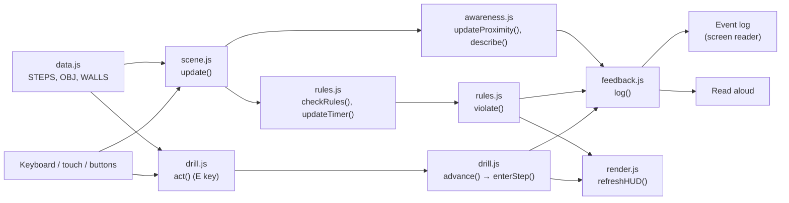

# B035 Lab Safety Simulator

A browser-based 2D lab safety drill set in room B035, the chemical engineering lab. Walk through the room, follow the safety steps, and respond to a spill, an eye splash and a fire alarm. It is designed to be playable with a keyboard, a screen reader, or read-aloud speech.

**Play online:** https://raaaandy.github.io/b035-lab-safety-sim/

This README has two parts:
- [Part 1: For players](#part-1-for-players): how to play
- [Part 2: For developers and contributors](#part-2-for-developers-and-contributors): how the code works and how to extend it

---

# Part 1: For players

## Getting started

Open the link above in Chrome, Edge or Firefox. Nothing needs to be installed.

To play without the website, download the whole folder and double-click `index.html` (an internet connection is still needed to load the game engine).

There are two versions:
- **Simple view** (`index.html`): the whole floor plan is visible at once, with high-contrast shapes and large labels. Recommended for low-vision players and screen reader users.
- **Pixel-art view** (`pixel.html`): a close-up, game-style view where the camera follows your character.

## Controls

| Action | Keyboard | Touch / mouse |
|---|---|---|
| Walk | WASD or arrow keys | Press and hold on the map |
| Interact, or read an object's safety note | E (or Space) | **Interact** button |
| Describe your surroundings | Q | **Describe** button |
| Start over | | **Restart** button |

Holding Shift makes you run, but running in the lab costs points.

## The drill

Follow the task card on the right. There are 8 steps:

1. Put on PPE at the cubbies by the entrance.
2. Get acetone from the flammables cabinet.
3. Dispense it in the fume hood.
4. Return it to the cabinet.
5. A spill appears: fetch the spill kit from the blue cabinet.
6. Clean up the spill without walking through it.
7. Eye splash: reach the eyewash station (below the centrifugal pump) within 10 seconds.
8. Fire alarm: leave through the nearest exit within 25 seconds.

A ring on the map marks your current target: green for normal tasks, red for urgent ones.

## Scoring

You start with 100 points and lose 10 for each of these (each counts once):
- Leaving the entrance area without PPE
- Dispensing acetone on an open bench
- Carrying acetone near the steam bench or heat exchanger
- Walking through the spill
- Running
- Missing a timer

## Accessibility features

- **Keyboard only.** The whole game can be played with the keyboard.
- **Screen readers.** Every instruction, success and mistake is posted to the event log, which screen readers announce automatically.
- **Read aloud.** The game can speak events itself. It is on by default; **turn it off if you use a screen reader**, or you will hear everything twice.
- **Describe (Q).** Tells you the three nearest objects, how far away they are in metres and in which compass direction, plus where your current target is. North is the top of the map.
- **Proximity cues.** You hear an object's name when you walk up to it, and "Press E" when you can use it.
- **Timer warning.** You hear "5 seconds left" during timed tasks.
- **Safety notes.** Press E next to any object to hear its safety note.

## Settings

| Setting | What it does |
|---|---|
| Read events aloud | Speaks every event (on by default) |
| Highlight the current target | Shows or hides the target ring |
| Alarm and alert sounds | Turns sound effects and the fire alarm on or off |

---

# Part 2: For developers and contributors

## Project files

```
index.html          page layout (side panel, buttons) and the list of scripts to load
css/style.css       colours, light/dark mode, side-panel styling
js/data.js          the room (walls, equipment, exits, spill) and the drill steps
js/utils.js         small helpers: colours, distances, compass directions
js/feedback.js      event log, screen reader announcements, read aloud, sounds
js/render.js        drawing: map, spill, guide ring, side-panel status, end screen
js/drill.js         what each step does when it starts, and the E key
js/rules.js         safety rules, timers, evacuation check
js/awareness.js     nearby objects, the "Nearby" box, Describe (Q)
js/scene.js         the Phaser scene: setup, movement, and the per-frame loop
js/main.js          starts the game and connects the buttons
pixel.html          pixel-art version (single file, same drill and rules)
README.md           this file
```

The scripts are plain `<script>` tags rather than ES modules, so the game still works when `index.html` is opened by double-clicking. They load in the order listed in `index.html`, and that order matters: data and helpers first, `main.js` last.

## Where to look for what

| I want to… | Edit |
|---|---|
| Change the room layout or an object's safety note | `js/data.js` (`WALLS`, `OBJ`, `EXITS`) |
| Change the wording or order of the drill | `js/data.js` (`STEPS`) |
| Change what pressing E does at a step | `js/drill.js` → `act()` |
| Add or change a safety rule | `js/rules.js` → `checkRules()` |
| Change timers or the 5-second warning | `js/rules.js` → `updateTimer()` |
| Change what screen readers hear or what is read aloud | `js/feedback.js` |
| Change the Describe (Q) output or proximity announcements | `js/awareness.js` |
| Change how the map or side panel looks | `js/render.js`, `css/style.css` |
| Change movement speed or controls | `js/scene.js` → `movePlayer()`, `create()` |

## How it fits together

`scene.js` defines one Phaser scene, `Lab`. The other files each add a group of methods to it (`RenderMethods`, `DrillMethods`, `RuleMethods`, `AwarenessMethods`), so inside any of them `this` is the scene. The game state lives in `this.s` (current step, score, PPE, what the player is carrying, spill, timer, violations).

Every frame, `update()` in `scene.js` runs:

```
movePlayer()       scene.js       keyboard / touch movement
checkRules()       rules.js       running, PPE, ignition, spill
updateTimer()      rules.js       countdown + 5-second warning
showTimer()        render.js      countdown on the task card
checkEvacuation()  rules.js       reached an exit during the fire alarm?
updateProximity()  awareness.js   "Nearby" box, E bubble, announcements
drawTargetRing()   render.js      pulsing ring on the current target
```



Two rules keep the game accessible:
- **Never show information only on the canvas.** If the player needs to know it, send it through `log()` or `announce()` in `feedback.js`.
- **Keep content in the data.** Add new rooms or steps by editing `data.js`, not by hard-coding them into the logic.

## Development setup

You can open `index.html` directly, but a local server behaves more like the real website:

```bash
python -m http.server 8000
# then open http://localhost:8000/
```

To work offline, download [phaser.min.js 3.80.1](https://cdnjs.cloudflare.com/ajax/libs/phaser/3.80.1/phaser.min.js) into the project folder and change the Phaser `<script>` line in `index.html` to `<script src="phaser.min.js"></script>`.

To test accessibility, try the game with a real screen reader (NVDA on Windows, VoiceOver on macOS) with read-aloud turned off.

## Planned features and where they go

### A. Realistic spill-response procedure

Right now the spill takes two actions: fetch the kit, then press E once at the spill. A real response has more stages, for example: alert people nearby, identify the chemical (check the SDS binder), check your PPE, contain the spill from the edges with absorbent socks, absorb it, bag and label it as hazardous waste, and report it. The actual procedure must be confirmed with the lab manager.

| Change | Where |
|---|---|
| New equipment (SDS binder, hazardous waste bin) | `OBJ` in `js/data.js` |
| Each stage as its own step | `STEPS` in `js/data.js`, between `kit` and `eyewash` |
| What pressing E does at each stage | a new `if (st.id === '...')` in `act()` in `js/drill.js` |
| Making the E prompt appear for the new stages | `actionTarget()` in `js/drill.js` (usually automatic if the step has a `target`) |
| New things the player carries (e.g. a filled waste bag) | new fields in `this.s` in `create()` (`js/scene.js`), shown in `refreshHUD()` (`js/render.js`) |
| Mistakes (wiping from the centre outward, skipping the SDS) | `violate()` calls in `act()` or `checkRules()` |
| Stages that take time ("hold E for 3 seconds") | a counter in `this.s`, increased in `update()` while E is held |

### B. Two-player co-op spill cleanup

Some spill tasks need two people: one keeps others away from the spill while the other fetches the kit, and both lay the absorbent together. A first version can run on one keyboard (Player 1: WASD + E, Player 2: arrow keys + Enter).

| Change | Where |
|---|---|
| Second player and its keys | `create()` and `movePlayer()` in `js/scene.js` (move for each player) |
| Actions know which player acted | `act(playerNumber)` in `js/drill.js`; `nearObj()` / `nearest()` in `js/awareness.js` take a player |
| Steps that need both players | add `coop: true` to those steps in `js/data.js`; in `act()`, complete them only when both players are in position |
| Rules for each player | loop over both players in `checkRules()` (`js/rules.js`) |
| Messages say which player | prefix `log()` messages with "Player 1:" / "Player 2:" so screen reader users know who is addressed |

Playing on two laptops needs a small server to pass messages between the browsers; do this only after the one-keyboard version works. Keep a single-player mode for players who can't share a keyboard, and don't time co-op steps by default.

## Adapting to another lab

1. Get the new room's floor plan (PDF or image).
2. Ask an AI coding assistant to trace it into `WALLS`, `EXITS` and `OBJ` in `js/data.js`, using the same format and the original image size as the coordinate system.
3. Update `STEPS` so the targets point to the new object `id`s.
4. Change `M_PER_PX` to match the real room width, and `START` in `js/scene.js` to the new entrance.
5. Walk the room in person to confirm where the safety equipment is. Floor plans usually do not show it.

## Publishing updates

The site is hosted on GitHub Pages from the `main` branch. Upload the whole folder (keeping the `css/` and `js/` folders); the site updates automatically within a minute or two. Check the **Actions** tab if it doesn't.

## Credits

Room layout traced from `BNS_035_Floor_Plan.pdf`. Built with Phaser 3.80.1 (MIT licence). All visuals are drawn in code.
